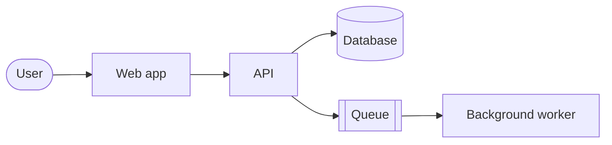

Copy this file, rename it, and replace the text. Set `draft: false` when the case study is ready to publish. Remove anything that could identify a client or share confidential details.

## The problem

Who needed what, and why the existing situation wasn't working. Two or three sentences.

## Constraints

- Budget, timeline and team size
- Systems that had to stay as they were
- Rules the design had to respect, such as security or data residency

## The architecture

A diagram does most of the work here. Mermaid code blocks render as diagrams:

Describe what each part is for and why it sits where it does.

## Trade-offs

What I gave up for what I gained. Link the decision records that explain the biggest choices.

## Outcome

What changed, with numbers where I have them and honest caveats where I don't.

## What I'd change

One or two things I'd do differently with what I know now.
